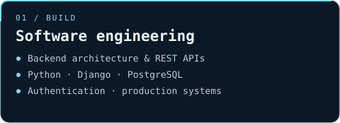
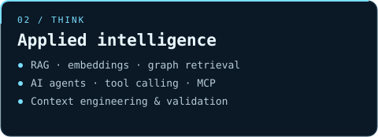
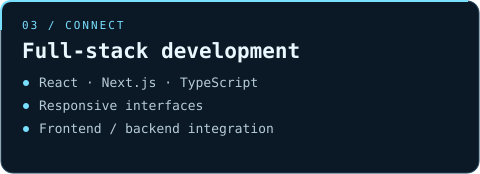
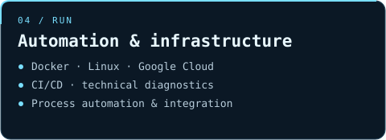
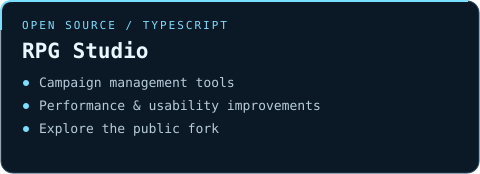
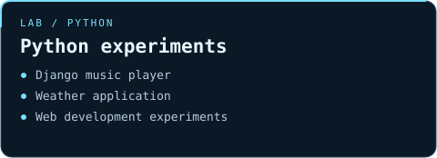

### Software Engineer · Backend · Applied AI

Building systems at the intersection of software, intelligence and creativity.

## 01 / Engineering domains

 

 

## 02 / Technology radar

## 03 / Workbench

 

## 04 / Activity

## 05 / Field notes

- **DeepRPG** — AI platform engineering, RAG, conversational memory and agent integrations.
- **Aria – Imagem e Tecnologia** — end-to-end asset management software, APIs, authentication and production delivery.
- **Marvin Net Group** — web development and maintenance.
- **VR Web Designer** — freelance software and web projects.

More about my background

My professional experience spans software engineering, backend architecture, full-stack development and commercial automation. My technical interests include authorized OSINT, intelligent systems, worldbuilding and creative tools.

Computer Science — Estácio · Technical training in Web Design — Microlins.

---

`coldhc@workspace:~$ explore > build > refine_`

Always another problem to solve. Always another world to build.

