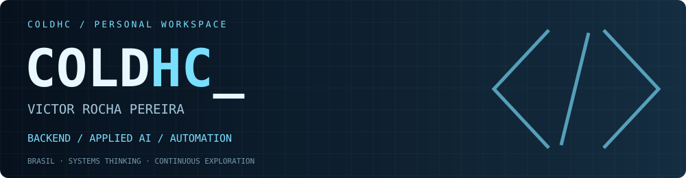

<div align="center">



**I build systems that connect code, intelligence and real-world problems.**

[](https://www.linkedin.com/in/victor-rocha-pereira-089923212/)
[](https://github.com/ColdHC?tab=repositories)

</div>

### 01 / Who's behind the terminal?

```yaml
identity: Victor Rocha Pereira
alias: ColdHC
location: Joinville, Brazil
background: Computer Science
core: Python backend engineering
interests:
  - Applied AI and intelligent agents
  - Automation and systems integration
  - Open-source software
  - Worldbuilding and digital creative tools
```

I'm drawn to problems that cross the boundaries between software, infrastructure and creativity. I work with backend systems, APIs and automation, and enjoy exploring how AI can become a useful component of real software rather than just a chat interface.

My current work in commercial automation keeps me close to real operational problems. Outside work, I experiment with software, RPG tools and interactive fictional worlds.

### 02 / The toolbox

| Layer | Technologies |
| :--- | :--- |
| Backend | Python · Django · Django REST Framework · REST APIs |
| Data | PostgreSQL · SQL · Pandas |
| Interface | TypeScript · JavaScript · React · Next.js |
| Infrastructure | Docker · Linux · Google Cloud · Cloud Run |
| Workflow | Git · GitHub · Postman · CI/CD |

<div align="center">


</div>

### 03 / Beyond conventional software

```text
  DATA ──────► CONTEXT ──────► INTELLIGENCE
    │             │                 │
    ▼             ▼                 ▼
  APIs           RAG          AI AGENTS
    │             │                 │
    └─────────────┴─────────────────┘
                  ▼
           USEFUL AUTOMATION
```

My areas of exploration include RAG, embeddings, agent orchestration, tool calling, MCP integrations, process automation and authorized OSINT with source validation.

### 04 / The workbench

**[RPG Studio — ColdHC fork](https://github.com/ColdHC/RPG-Studio-Cold)**  
Open-source campaign management tooling. My work focuses on improving performance, usability and the experience of creating and organizing fictional worlds.

**[Music Player](https://github.com/ColdHC/music-player)** · Django-based music player project.

**[Weather App](https://github.com/ColdHC/weather-app)** · Python weather application.

**[Blog Study](https://github.com/ColdHC/Blog-study)** · Django development experiments.

[Browse all public repositories](https://github.com/ColdHC?tab=repositories)

### 05 / Journey so far

| Period | Experience |
| :--- | :--- |
| 2026 — present | Commercial Automation Technician |
| 2025 — 2026 | Web Developer · DeepRPG |
| 2024 | Software Developer · Marvin net group |
| 2022 — 2025 | Back End Developer · Aria – Imagem e Tecnologia |
| 2021 — 2023 | Freelance Junior Python Developer · VR Web Designer |

At DeepRPG, I worked on backend systems for AI agents, REST APIs, RAG pipelines and service orchestration, alongside React/Next.js frontend development.

**Education:** Computer Science · Estácio (2022–2026) / Technical training in Web Design · Microlins (2019).

---

<div align="center">

`coldhc@workspace:~$ explore > build > refine_`

<sub>Always another problem to solve. Always another world to build.</sub>

</div>
